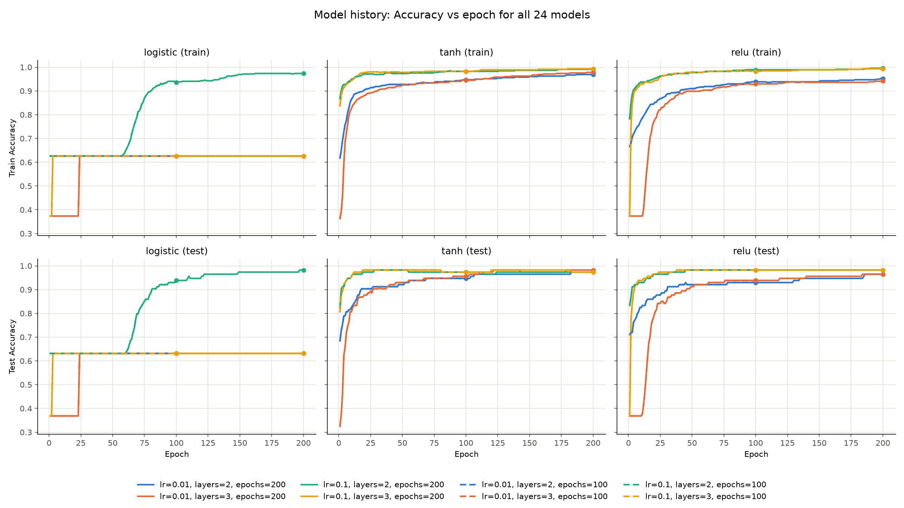
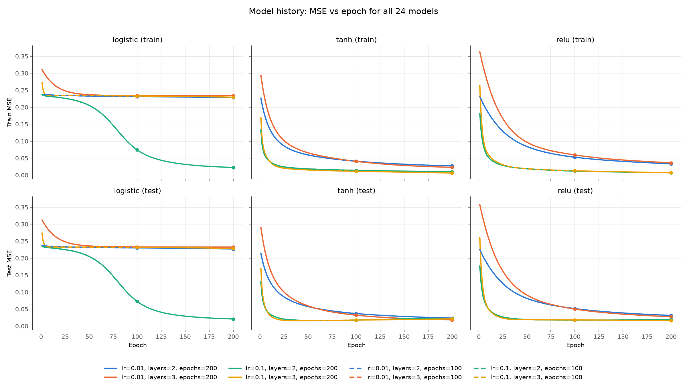

# Neural Network Project

**Group members:** Hishita Shah (hrs220004), Megan Chacko (msc220005)

## Dataset
Breast Cancer Wisconsin (Diagnostic), UCI ML Repository:
https://archive.ics.uci.edu/dataset/17/breast+cancer+wisconsin+diagnostic

The code reads the data straight from the public UCI file, so no data is included in this submission:
`https://archive.ics.uci.edu/ml/machine-learning-databases/breast-cancer-wisconsin/wdbc.data`

- 569 instances, 30 real-valued features, binary label `Diagnosis` (M = malignant, B = benign)
- The file has no header row. The code assigns the column names: `ID`, `Diagnosis`, and `<feature>_{mean,se,worst}` for the 10 base features.

## Setup
Requires Python 3.8+.
```
pip install -r requirements.txt
```

## How to run
```
# uses the public UCI URL by default
python NeuralNet.py

# or point to any local path / URL
python NeuralNet.py --data path/to/wdbc.data
```

The run takes about 10–15 seconds. It prints the data-cleaning counts (duplicate rows removed, rows with an invalid label removed, missing values filled), the train/test sizes, one line per trained model, the full results table, the best model, and the mean test accuracy for each hyperparameter value. The outputs are written to `results/`:

| File | Contents |
|---|---|
| `results/results.csv` / `results/results.md` | Results table for all 24 models, sorted by test accuracy |
| `results/history_acc.png` | Model history: train and test accuracy vs epoch for every model |
| `results/history_mse.png` | Model history: train and test MSE vs epoch for every model |

## Modifications to the template
- `__main__` reads the data path from the `--data` command-line argument instead of a hardcoded `"train.csv"`.
- `__init__` now uses the `header` flag (`header=False` for wdbc.data) and assigns the column names.
- `preprocess` drops `ID`, coerces features to numeric (`?`/blank become NaN), removes duplicates and rows with an invalid label, imputes missing features with the column median, encodes `Diagnosis` as M = 1 / B = 0, and moves it to the last column.
- `preprocess` also does the train/test split and then standardizes the features (`StandardScaler`). The split happens first so the scaler is fit on the training set only and no test data leaks into training. It stores the standardized `X_train`, `X_test`, `y_train`, `y_test`, which `train_evaluate` uses directly instead of splitting the data itself.
- `__init__` takes optional `seed` (42), `test_size` (0.2), `neurons` (16) and `out_dir` (`"results"`) arguments.
- The split is stratified and seeded (`train_test_split(..., stratify=y, random_state=seed)`) instead of the template's unseeded default, so runs are reproducible.
- `train_evaluate` keeps the template's hyperparameter grid and trains every combination (3 × 2 × 2 × 2 = 24 models). Two helper methods were added:
  - `train_model` trains one `MLPClassifier` one epoch at a time with `partial_fit` and records train/test accuracy, MSE and log-loss after each epoch.
  - `plots` draws the model-history plots.
- The template asks for all models on a single plot with a different color per model. 24 lines on one axis is unreadable, so (as the assignment allows) each figure is split into three panels, one per activation function. Within a panel, color identifies the learning rate and layer count, and line style identifies the epoch count (solid = 200, dashed = 100), so each model has a unique color + style.
- Errors are reported as MSE (as the assignment suggests) and also as log-loss.

## Results
All 24 models, sorted by test accuracy (ties broken by test MSE). Train/test sizes are 455/114.

| Activation   |   Learning Rate |   Epochs |   Hidden Layers |   Neurons/Layer |   Train Acc |   Test Acc |   Train MSE |   Test MSE |   Train LogLoss |   Test LogLoss |
|:-------------|----------------:|---------:|----------------:|----------------:|------------:|-----------:|------------:|-----------:|----------------:|---------------:|
| relu         |          0.1000 |      200 |               3 |              16 |      0.9934 |     0.9825 |      0.0068 |     0.0160 |          0.0257 |         0.0877 |
| relu         |          0.1000 |      100 |               2 |              16 |      0.9890 |     0.9825 |      0.0117 |     0.0174 |          0.0471 |         0.0746 |
| relu         |          0.1000 |      100 |               3 |              16 |      0.9824 |     0.9825 |      0.0127 |     0.0179 |          0.0467 |         0.0827 |
| tanh         |          0.0100 |      200 |               3 |              16 |      0.9780 |     0.9825 |      0.0228 |     0.0183 |          0.0947 |         0.0832 |
| relu         |          0.1000 |      200 |               2 |              16 |      0.9956 |     0.9825 |      0.0070 |     0.0193 |          0.0290 |         0.0920 |
| logistic     |          0.1000 |      200 |               2 |              16 |      0.9736 |     0.9825 |      0.0224 |     0.0208 |          0.0965 |         0.0905 |
| tanh         |          0.1000 |      100 |               2 |              16 |      0.9824 |     0.9737 |      0.0139 |     0.0174 |          0.0561 |         0.0691 |
| tanh         |          0.1000 |      100 |               3 |              16 |      0.9824 |     0.9737 |      0.0113 |     0.0176 |          0.0469 |         0.0745 |
| tanh         |          0.1000 |      200 |               3 |              16 |      0.9934 |     0.9737 |      0.0061 |     0.0212 |          0.0278 |         0.0897 |
| tanh         |          0.1000 |      200 |               2 |              16 |      0.9912 |     0.9737 |      0.0099 |     0.0229 |          0.0410 |         0.0871 |
| tanh         |          0.0100 |      200 |               2 |              16 |      0.9692 |     0.9737 |      0.0270 |     0.0234 |          0.1094 |         0.0975 |
| relu         |          0.0100 |      200 |               3 |              16 |      0.9429 |     0.9649 |      0.0361 |     0.0276 |          0.1252 |         0.1032 |
| relu         |          0.0100 |      200 |               2 |              16 |      0.9516 |     0.9649 |      0.0333 |     0.0313 |          0.1221 |         0.1161 |
| tanh         |          0.0100 |      100 |               3 |              16 |      0.9451 |     0.9561 |      0.0404 |     0.0319 |          0.1571 |         0.1354 |
| tanh         |          0.0100 |      100 |               2 |              16 |      0.9473 |     0.9474 |      0.0409 |     0.0367 |          0.1620 |         0.1496 |
| relu         |          0.0100 |      100 |               3 |              16 |      0.9297 |     0.9386 |      0.0593 |     0.0499 |          0.2087 |         0.1863 |
| logistic     |          0.1000 |      100 |               2 |              16 |      0.9363 |     0.9386 |      0.0742 |     0.0726 |          0.2921 |         0.2877 |
| relu         |          0.0100 |      100 |               2 |              16 |      0.9385 |     0.9298 |      0.0526 |     0.0512 |          0.1942 |         0.1912 |
| logistic     |          0.0100 |      200 |               2 |              16 |      0.6264 |     0.6316 |      0.2280 |     0.2269 |          0.6481 |         0.6459 |
| logistic     |          0.1000 |      200 |               3 |              16 |      0.6264 |     0.6316 |      0.2292 |     0.2281 |          0.6507 |         0.6484 |
| logistic     |          0.0100 |      100 |               2 |              16 |      0.6264 |     0.6316 |      0.2314 |     0.2301 |          0.6552 |         0.6527 |
| logistic     |          0.1000 |      100 |               3 |              16 |      0.6264 |     0.6316 |      0.2330 |     0.2317 |          0.6586 |         0.6561 |
| logistic     |          0.0100 |      200 |               3 |              16 |      0.6264 |     0.6316 |      0.2339 |     0.2326 |          0.6605 |         0.6579 |
| logistic     |          0.0100 |      100 |               3 |              16 |      0.6264 |     0.6316 |      0.2341 |     0.2329 |          0.6610 |         0.6586 |

Mean test accuracy for each hyperparameter value:

| Hyperparameter | Value → mean test accuracy |
|---|---|
| Activation | logistic 0.714 · tanh 0.969 · relu 0.966 |
| Learning rate | 0.01 → 0.849 · 0.1 → 0.917 |
| Epochs | 100 → 0.877 · 200 → 0.890 |
| Hidden layers | 2 → 0.909 · 3 → 0.857 |

### Model history plots




Note on the dashed (100-epoch) lines: each 100-epoch model uses the same seed as its 200-epoch counterpart, so its curve is identical for the first 100 epochs and lies underneath the solid line. The dot at epoch 100 marks where the 100-epoch model stopped.

## Report
**Best activation: tanh and relu.** Their mean test accuracies (0.969 and 0.966) are nearly the same, and both reach about 97–98% test accuracy in every configuration. The best test accuracy, 0.9825, is shared by six models, four of them relu with learning rate 0.1. The logistic (sigmoid) activation is far behind with a mean of 0.714. Six of its eight models never learned anything and stayed at 0.6316 test accuracy, which is simply predicting "benign" for every sample (72 of the 114 test samples are benign).

**Why sigmoid did poorly.** The sigmoid derivative is at most 0.25 (at 0), and backpropagation multiplies one such factor per layer, so the gradient reaching the early layers shrinks quickly. This is the vanishing-gradient problem. Sigmoid outputs are also always positive (not zero-centered), which makes weight updates less efficient. tanh has a derivative of 1 at 0 and is zero-centered, and relu has a derivative of 1 for every positive input, so gradients pass through the layers almost undiminished. The history plots show this: the sigmoid curves stay flat at the majority-class accuracy, while tanh and relu climb within the first 10–25 epochs. The only sigmoid models that escaped the plateau used the larger learning rate *and* only 2 layers (the plateau ends around epoch 60), which fits the vanishing-gradient explanation: a bigger step size helps, and an extra layer adds another 0.25 factor.

**Learning rate.** 0.1 beat 0.01 on average (0.917 vs 0.849). Because we use plain SGD with no momentum, the learning rate is exactly the step size, and with 0.01 the tanh/relu models were still improving at epoch 200 (their MSE curves are still going down), while with 0.1 they converged within about 25 epochs. On this small, well-conditioned dataset 0.1 did not cause instability.

**Epochs.** 200 epochs beat 100 on average (0.890 vs 0.877). The gain comes almost entirely from the slow-learning lr = 0.01 models. For lr = 0.1 the extra epochs gave no improvement, and the test MSE of the tanh lr = 0.1 models rose slightly after about epoch 50 (2 layers: 0.0174 at epoch 100 → 0.0229 at epoch 200) while train MSE kept falling. That is mild overfitting.

**Hidden layers.** 2 layers beat 3 on average (0.909 vs 0.857), but that difference comes from the sigmoid models (vanishing gradients get worse with depth). For tanh and relu, 2 and 3 layers performed about the same, since the dataset is small and nearly linearly separable, so the extra capacity isn't needed.

**Overfitting.** The good models have a train/test accuracy gap of only about 1–2 points (e.g. 0.993 train vs 0.982 test), so overfitting is small. It shows up mainly in the slight rise in test MSE described above.

**Summary.** For this dataset, tanh or relu with learning rate 0.1 and 2 hidden layers is enough to reach about 98% test accuracy within 100 epochs. Sigmoid needs a larger learning rate and a shallower network to train at all.

## Assumptions
- **Dataset:** Breast Cancer Wisconsin (Diagnostic) from the UCI repository, read from its public URL. `ID` is dropped because it is a sample identifier, not a feature.
- **Hyperparameter grid:** the one provided in the starter code's `train_evaluate`: activations `logistic`, `tanh`, `relu`; learning rates 0.01 and 0.1; 100 and 200 epochs; 2 and 3 hidden layers.
- **Hidden layer width:** 16 neurons in every hidden layer (the template allows any fixed number).
- **Optimizer:** plain stochastic gradient descent (`solver='sgd'`, `momentum=0`), so the learning rate is the step size η. scikit-learn's defaults otherwise apply (mini-batch size 200, L2 penalty α = 0.0001, constant learning rate).
- **Epochs:** one epoch is one full pass over the training set, done with one `partial_fit` call. Each model is trained for exactly that many epochs, with no early stopping.
- **Split:** 80/20 train/test, stratified by class, with random seed 42. The same seed initializes the network weights, so results are reproducible.
- **Standardization:** `StandardScaler` fit on the training set only, then applied to both sets.
- **Missing values:** filled with the column median computed over the whole dataset before the split. This is a minor theoretical leak, but the dataset has no missing values, so it has no effect.
- **Errors:** MSE is computed between the true label (0/1) and the predicted probability of malignant. Log-loss is also reported. Accuracy uses a 0.5 threshold.
- **Label encoding:** malignant = 1, benign = 0.

## References
- UCI ML Repository, Breast Cancer Wisconsin (Diagnostic) dataset
- scikit-learn documentation: `MLPClassifier`
